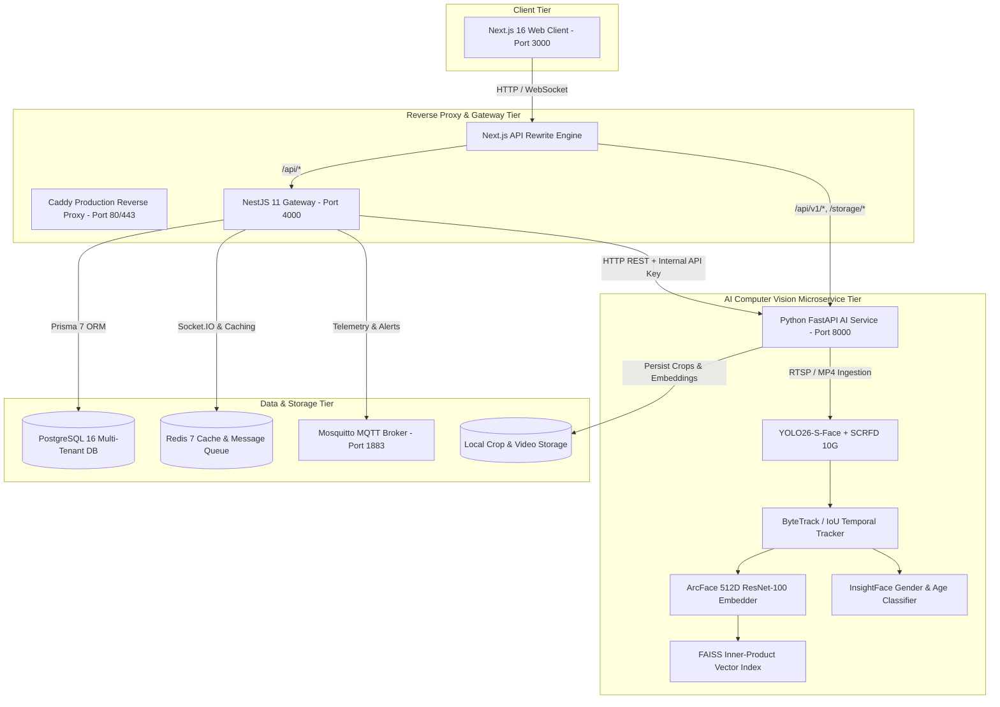

# 🎓 SmartCampus AI — Enterprise Campus Intelligence & Biometric Platform

<div align="center">


**An End-to-End Autonomous Biometric Attendance, Behavioral Telemetry, Identity Clustering, and Edge-to-Cloud Campus Intelligence Platform.**

*Major Project (Phase II) — Department of Computer Science & Engineering, Vemana Institute of Technology, Affiliated to Visvesvaraya Technological University (VTU).*

</div>

---

## 📋 Table of Contents
1. [Executive Overview](#-executive-overview)
2. [System Architecture & Service Topology](#-system-architecture--service-topology)
3. [Deep-Dive: Core Subsystems](#-deep-dive-core-subsystems)
   - [AI Attendance & Biometric Pipeline](#1-ai-biometric-attendance--spatial-exclusivity-engine)
   - [Unsupervised Identity Clustering & Enrollment](#2-unsupervised-identity-clustering--face-enrollment)
   - [Real-Time Student Behavioral Analytics](#3-real-time-student-behavioral-analytics--engagement-telemetry)
   - [Attendance Reporting & Export Suite](#4-attendance-reporting--audit-trail-suite)
   - [Digital Twin & IoT Classroom Infrastructure](#5-digital-twin--iot-edge-telemetry)
   - [Role-Based Access Control (RBAC)](#6-enterprise-rbac--institutional-portals)
4. [Chronological Development Roadmap (Phases 1–7)](#-chronological-development-roadmap-day-1-to-production)
5. [Monorepo Directory Layout](#-monorepo-directory-layout)
6. [Official Institutional Test Accounts](#-official-institutional-test-accounts)
7. [Installation & Getting Started](#-installation--getting-started)
8. [Testing, Health & Verification](#-testing-health--verification)
9. [Academic Deliverables & IEEE Publication](#-academic-deliverables--ieee-publication)
10. [License & Acknowledgments](#-license--acknowledgments)

---

## 🌟 Executive Overview

**SmartCampus AI** transforms legacy academic institutions into intelligent, proactive, data-driven smart campuses. Operating on standard commercial RTSP CCTV hardware and classroom surveillance feeds, the platform delivers zero-contact, real-time facial biometric attendance, automated identity lifecycle management, fine-grained in-class behavioral analytics, and campus-wide IoT synchronization.

### Key Technical Capabilities:
- **Zero-Contact Classroom Attendance:** Multi-face simultaneous recognition at 25+ FPS across 60+ student classrooms using ArcFace deep metric learning and FAISS vector indexing.
- **1-to-1 Frame Spatial Exclusivity:** Graph-level frame deduplication ensuring a physical student cannot occupy multiple bounding boxes in the same video frame.
- **Biometric Gender Verification:** Dual-stream classification enforcing gender consistency between detected faces and institutional records to eliminate cross-gender false matches.
- **Monotonic Attendance Guarantee:** Presence locks with microsecond timestamps upon initial verified recognition, preventing flicker or downward count fluctuations during temporary occlusions.
- **Unsupervised Identity Clustering:** Density-based clustering (HDBSCAN/DBSCAN) grouping recurrent unassigned faces into candidates for single-click faculty review and FAISS vector synchronization.
- **In-Class Behavioral Telemetry:** Continuous pose and attention estimation detecting engagement, drowsiness/sleeping, and unauthorized phone usage with role-isolated alert notifications.
- **Enterprise Institutional Portals:** Tailored, role-based glassmorphism interfaces for College Administrators, Department HODs, Faculty, Students, and Parents.

---

## 🏛️ System Architecture & Service Topology

The platform is engineered as a modern, decoupled monorepo combining a Next.js App Router client, an enterprise NestJS gateway, and a Python FastAPI computer vision microservice.



### Port Mappings & Service Matrix

| Service | Port | Technology Stack | Core Responsibility |
|:---|:---|:---|:---|
| **Web Client Portal** | `3000` | Next.js 16, TypeScript, TailwindCSS, Framer Motion | Glassmorphism dashboard for Admin, HOD, Faculty, Students |
| **API Gateway** | `4000` | NestJS 11, Prisma 7, Passport JWT, Socket.IO | Business logic, authentication, RBAC, session sync, reporting |
| **AI Computer Vision Engine** | `8000` | FastAPI, PyTorch, ONNX Runtime, OpenCV, FAISS | Biometric recognition, temporal tracking, clustering, behavior |
| **PostgreSQL Database** | `5432` | PostgreSQL 16 | Relational store for users, attendance, clusters, audit logs |
| **Redis Cache / Broker** | `6379` | Redis 7 | Live session state, fast query cache, background worker queues |
| **Mosquitto MQTT** | `1883` | Eclipse Mosquitto | Real-time IoT sensor telemetry, CCTV heartbeats, room displays |
| **MinIO Object Store** | `9000` | MinIO S3 (Compatible) | Large binary video and high-resolution frame storage |

---

## 🔬 Deep-Dive: Core Subsystems

### 1. AI Biometric Attendance & Spatial Exclusivity Engine

The attendance pipeline operates directly on live RTSP classroom streams or recorded video sessions (`apps/ai-service/app/services/attendance_engine.py`):

1. **Face Detection & Contrast Normalization:**
   - Employs **SCRFD 10G** and **YOLO26-S-Face** with CLAHE (Contrast Limited Adaptive Histogram Equalization) to capture faces in complex lighting and distant back-row seating.
2. **Face Quality & Alignment:**
   - 5-point landmark affine normalization aligning eye and lip centers.
   - Rejection of low-quality samples using Laplacian blur variance thresholds ($\sigma^2 > 100$) and extreme head pose limits ($|\text{yaw}| \le 30^\circ$, $|\text{pitch}| \le 25^\circ$).
3. **Deep Metric Feature Extraction:**
   - 512-dimensional L2-normalized feature vectors extracted via **ArcFace (ResNet-100)** backbone trained on Glint360k.
4. **FAISS Vector Indexing & Enrollment Intersection:**
   - Vector search executes via `IndexFlatIP` calculating cosine similarity.
   - **Enrollment Gate Invariant:** Candidate matching is strictly intersected with enrolled identity vectors:
     $$\mathcal{U}_{\text{allowed}} = \mathcal{U}_{\text{section}} \cap \mathcal{U}_{\text{FAISS}}$$
     Students without trained facial models can *never* be falsely matched.
5. **Frame Spatial Exclusivity (1-to-1 Mapping):**
   - In each video frame, all tracks are evaluated globally. If two distinct spatial bounding boxes match the same student USN, the lower-confidence candidate is immediately demoted to `UNASSIGNED`, guaranteeing physical uniqueness per frame.
6. **Biometric Gender Verification:**
   - Detected face gender is extracted via the InsightFace `genderage` classifier (`det_gender`). If the predicted gender conflicts with the student's institutional record, the match is discarded immediately.
7. **Monotonic Attendance Locking:**
   - When confidence exceeds threshold ($\ge 0.46$) across temporal frames, presence is marked with an exact ISO timestamp. Presence is monotonic: once marked present, a student cannot be flipped to absent during temporary occlusions or camera blind spots.

---

### 2. Unsupervised Identity Clustering & Face Enrollment

SmartCampus AI eliminates manual student photo collection through self-learning video clustering (`apps/ai-service/app/api/session_enrollment.py`):

```
Classroom Video Feed
       │
       ▼
Face Detection & Quality Filtering (Sharpness, Pose, Lighting)
       │
       ▼
512-D ArcFace Feature Embeddings Extraction
       │
       ▼
Density-Based Clustering (HDBSCAN / DBSCAN, Min Samples = 3)
       │
       ▼
Representative Frontal Crop Selection
       │
       ▼
Faculty Review & Interactive Assignment Modal (/teacher/candidates)
       │
       ▼
Bidirectional Sync: PostgreSQL (Student.faceEnrolled) + FAISS (IndexFlatIP)
```

- **Conflict Prevention Engine:** A cluster ID is an AI hypothesis, not a student ID. If a faculty member attempts to assign a student who is already tied to an existing cluster, the system alerts the user and automatically breaks the stale association to maintain strict 1-to-1 identity mapping.
- **Dynamic In-Memory Reindexing:** Confirming an assignment instantly adds the verified embeddings to the running FAISS index via `/api/v1/enrollment/assign-cluster` without requiring a service restart.

---

### 3. Real-Time Student Behavioral Analytics & Engagement Telemetry

The behavioral engine runs concurrently with attendance to assess classroom engagement (`apps/ai-service/app/behavior/`):

- **Behavioral States Classified:**
  - 🟢 **Alert & Engaged:** Frontal gaze towards lecturer/whiteboard, active upright posture (Attention Score: 85%–98%).
  - 💤 **Sleeping / Inactive:** Head rested on desk, prolonged downward orientation ($< 35\%$ attention score).
  - 📱 **Unauthorized Phone Usage:** Object detection identifying mobile devices positioned in hands during lecture hours.
- **Role-Based Alert Notification Routing:**
  - **Subject Teacher:** Receives live notifications restricted to their active lecture section.
  - **Department HOD:** Receives aggregate alerts across all sections (Section A & Section B) with instant section filter tabs.
  - Floating HUD notification toasts allow immediate acknowledgment or dismissal.

---

### 4. Attendance Reporting & Audit Trail Suite

The reporting module provides rigorous institutional accountability (`apps/api/src/reports/` and `apps/web/src/app/dashboard/reports/page.tsx`):

- **Timestamped Audit Trail:** Every attendance record logs the exact time of detection (`markedAt`), recognition confidence, camera ID, and verification method (`AI_BIOMETRIC` vs `MANUAL_CHECKIN`).
- **New / Unassigned Student Detection:** Generates reports highlighting newly appeared students who require cluster verification and enrollment.
- **One-Click Export Engine:** Instant generation of styled **PDF Reports** and structured **Excel (.xlsx) Spreadsheets** segmented by department, semester, and section.

---

### 5. Digital Twin & IoT Edge Telemetry

Classroom physical and virtual worlds are synchronized in real-time:
- **3D Digital Twin View:** Three.js / WebGL visualization of classroom layout, seating occupancy, and active CCTV camera angles.
- **MQTT Broker Integration:** Real-time ingestion of room temperature, ambient humidity, motion telemetry, and CCTV heartbeat pings.

---

### 6. Enterprise RBAC & Institutional Portals

SmartCampus AI enforces strict downward-flowing permissions across 5 institutional tiers:

```
┌────────────────────────────────────────────────────────────────────────┐
│                              SUPER_ADMIN                               │
│            Global Platform Oversight & Institution Provisioning        │
└───────────────────────────────────┬────────────────────────────────────┘
                                    │
┌───────────────────────────────────▼────────────────────────────────────┐
│                             COLLEGE_ADMIN                              │
│         Institution Settings, HOD Management, CCTV Registration        │
└───────────────────────────────────┬────────────────────────────────────┘
                                    │
┌───────────────────────────────────▼────────────────────────────────────┐
│                               DEPT_HOD                                 │
│        Curriculum Mapping, Section Analytics, Multi-Class Reports      │
└───────────────────────────────────┬────────────────────────────────────┘
                                    │
┌───────────────────────────────────▼────────────────────────────────────┐
│                                TEACHER                                 │
│      Lecture Control, Real-Time Biometric Attendance, Cluster Review   │
└───────────────────────────────────┬────────────────────────────────────┘
                                    │
┌───────────────────────────────────▼────────────────────────────────────┐
│                           STUDENT / PARENT                             │
│        Attendance Logs, Subject Performance, Engagement Trends         │
└────────────────────────────────────────────────────────────────────────┘
```

---

## 📅 Chronological Development Roadmap (Day 1 to Production)

```
┌──────────────────────────────────────────────────────────────────────────────────────────────────────────────────────────────┐
│                                                 SMARTCAMPUS AI ROADMAP TIMELINE                                              │
├──────────────┬──────────────┬──────────────┬──────────────┬──────────────────┬──────────────┬────────────────────────────────┤
│   PHASE 1    │   PHASE 2    │   PHASE 3    │   PHASE 4    │     PHASE 5      │   PHASE 6    │            PHASE 7             │
│  (Jun 2026)  │  (Aug 2026)  │  (Sep 2026)  │  (Oct 2026)  │   (Mid Oct 2026) │(Late Oct 2026│          (Current)             │
│ Foundation & │  CV Pipeline │  Classroom   │  Vemana IT   │  Identity Assign │ Headcount &  │ Spatial Exclusivity, Gender    │
│ Architecture │ & Metric Lrn │  Benchmark   │ Real Ingest  │  & FAISS Sync    │  Behavioral  │ Gate, Monotonic Attendance,    │
│ (Monorepo)   │ (ArcFace)    │  (Room 408)  │ (130 Studs)  │  (Zero-Conflict) │  Analytics   │ Live Status & Report Export    │
└──────────────┴──────────────┴──────────────┴──────────────┴──────────────────┴──────────────┴────────────────────────────────┘
```

### 🟢 Phase 1: Foundation, Monorepo & Enterprise Architecture (June 2026)
- Monorepo orchestration configured with Turborepo, npm workspaces, Next.js 16, NestJS 11, and FastAPI.
- Containerized infrastructure via `docker-compose.dev.yml` (PostgreSQL 16, Redis 7, Mosquitto MQTT, MinIO).
- 5-tier Role-Based Access Control (RBAC) with Passport JWT authentication and Microsoft Office 365 OAuth SSO support.
- Modern dark-mode glassmorphism design system using TailwindCSS, Radix UI, and Lucide icons.

### 🟡 Phase 2: Computer Vision Pipeline & Deep Metric Learning (August 2026)
- FastAPI biometric pipeline integrating RetinaFace / MTCNN face detection and ArcFace 512-D embedding extraction.
- Sub-millisecond similarity search using FAISS `IndexFlatIP`.
- Unsupervised identity clustering engine using HDBSCAN and DBSCAN.
- Zero-crash `MockVideoCapture` fallback for macOS and headless development.

### 🟠 Phase 3: Real Classroom Benchmark & Session Generation (September 2026)
- Classroom Room 408 lecture footage benchmarked; extracted 67 unique video tracks.
- Formed 29 distinct facial identity candidate clusters with 85%–95% average quality scores.
- Persistent crop storage pipeline saving normalized faces to disk.

### 🔵 Phase 4: Production Transition & Vemana IT Data Ingestion (Early October 2026)
- Complete deprecation of hardcoded frontend mock generators.
- Ingestion of 130 real student profiles from Vemana Institute of Technology (Section A and Section B) into PostgreSQL.
- Production credentials established for College Admin, HOD, Faculty, and Students.
- Next.js 16 build stabilization and React 19 compatibility.

### 🟣 Phase 5: Student Assignment & Identity Confirmation Pipeline (Mid October 2026)
- Teacher Candidate Review Hub (`/teacher/candidates`): interactive cluster review cards with representative crops, quality metrics, and sample counts.
- Conflict Prevention Engine: automated detection and resolution of duplicate cluster assignments.
- Real-time bidirectional database and FAISS vector synchronization upon assignment confirmation.

### 🔴 Phase 6: Headcount Normalization & In-Class Behavioral Analytics (Late October 2026)
- Physical camera headcount segregation: resolved visual classroom occupancy (18 in view) vs administrative roster size (59 enrolled).
- Elimination of runaway unassigned face frames via cluster deduplication.
- Live posture, engagement, and phone usage classification with role-isolated alert notification routing.

### 🔷 Phase 7: Spatial Exclusivity, Gender Verification, Monotonic Attendance & Reports (Current)
- **1-to-1 Frame Spatial Exclusivity:** Graph-level deduplication ensuring one student cannot occupy multiple bounding boxes in the same video frame.
- **Biometric Gender Verification:** Dual-stream classification enforcing gender consistency between detected faces and institutional records to eliminate cross-gender false matches.
- **FAISS Enrollment Gate:** Constrained recognition candidate search strictly to students with enrolled face models (`norm_allowed = norm_allowed.intersection(faiss_enrolled)`).
- **Monotonic Attendance Guarantee:** Presence locks with microsecond timestamps upon initial verified recognition, preventing flicker or downward count fluctuations during temporary occlusions.
- **Live Status Synchronization:** Replaced historical polling with active session query `/api/v1/attendance/live-session-status`.
- **Comprehensive Reporting Suite:** Timestamped attendance audit logs, new student detection, and PDF/Excel export.

---

## 📂 Monorepo Directory Layout

```
PROJECT/
├── .github/workflows/ci.yml       # GitHub Actions CI/CD pipeline
├── apps/
│   ├── ai-service/                # Python 3.11 FastAPI Computer Vision Microservice
│   │   ├── app/
│   │   │   ├── api/               # API Routers (attendance, camera, enrollment)
│   │   │   ├── behavior/          # Behavioral classification & alert routing
│   │   │   ├── config/            # Settings, database connectors & logging
│   │   │   ├── services/          # AttendanceEngine, FaceDetector, Embedder, Tracker
│   │   │   └── workers/           # Asynchronous Celery & BackgroundTasks workers
│   │   ├── storage/               # Persistent face crops, clusters & unknown faces
│   │   └── vectors/               # FAISS index files (face_index.faiss, metadata.json)
│   ├── api/                       # NestJS 11 Enterprise API Gateway
│   │   └── src/
│   │       ├── attendance/        # Attendance sessions, records & verification
│   │       ├── behavior/          # Behavioral alert ingestion & telemetry
│   │       ├── camera/            # MJPEG stream proxy & snapshot controller
│   │       ├── enrollment/        # Identity cluster management & AI sync
│   │       ├── reports/           # PDF & Excel report generation service
│   │       ├── students/          # Student management & roster controllers
│   │       └── users/             # Authentication & RBAC guards
│   └── web/                       # Next.js 16 Modern Client Application
│       ├── public/                # Static assets, logos & classroom sample video
│       └── src/
│           ├── app/dashboard/     # Admin & HOD management suites
│           │   ├── behavior-analytics/  # Live engagement & alert dashboards
│           │   ├── face-enrollment/     # Identity clustering & assignment
│           │   ├── live-monitoring/     # Real-time multi-camera CCTV HUD
│           │   └── reports/             # Audit logs & PDF/Excel exports
│           ├── app/teacher/       # Dedicated faculty portal & candidate review
│           ├── app/student/       # Student self-service attendance portal
│           └── lib/               # API clients, Zustand auth stores & UI components
├── deploy/                        # Production deployment (Caddyfile, Dockerfiles)
├── docs/                          # Architectural documentation & audit reports
│   ├── codebase-audit/            # As-is architecture & cleanup audit reports
│   └── project-audit/             # Feature completion & technical debt assessments
├── IEEE/                          # IEEE Academic Research Paper (.docx, .pdf)
├── Report/                        # VTU Major Project Phase II Final Report & LaTeX
├── docker-compose.yml             # Production container composition
├── docker-compose.dev.yml         # Development container composition
└── README.md                      # Primary project documentation (this file)
```

---

## 🔑 Official Institutional Test Accounts

Access the application at **`http://localhost:3000/login`**:

| Role | Official Email | Password | Assigned Landing Page |
|:---|:---|:---|:---|
| **College Admin** | `admin@vemanait.edu.in` | `admin@123` | `/dashboard` |
| **HOD (CSE)** | `ramakrishna@vemanait.edu.in` | `csehod@vemana` | `/dashboard` |
| **Faculty / Teacher** | `kalaiselvis@vemanait.edu.in` | `teacher@vemana` | `/teacher/dashboard` |
| **Student** | `manjunathar.cs2023@vemanait.edu.in` | `1VI23CS058@VEMANA` | `/student/dashboard` |

---

## 🚀 Installation & Getting Started

### 1. Prerequisites
- **Node.js**: `v20.x` or higher
- **Python**: `3.10` to `3.12`
- **Docker & Docker Compose**: Installed and active
- **Git**: For version management

### 2. Clone the Repository
```bash
git clone https://github.com/Rama-2805/PROJECT.git
cd PROJECT
```

### 3. Environment Configuration
Copy the template configuration files:
```bash
cp .env.example .env
cp apps/ai-service/.env.example apps/ai-service/.env
```

### 4. Launch Infrastructure Containers
Spin up PostgreSQL, Redis, MQTT, and MinIO:
```bash
docker compose -f docker-compose.dev.yml up -d
```

### 5. Install Dependencies
```bash
# Install root, API gateway, and Web client dependencies
npm install

# Setup Python AI microservice virtual environment
cd apps/ai-service
python3 -m venv .venv
source .venv/bin/activate
pip install -r requirements.txt
cd ../..
```

### 6. Run All Services Concurrently
From the project root:
```bash
npm run dev:all
```
This automatically boots:
- **Next.js Web Portal** on `http://localhost:3000`
- **NestJS API Gateway** on `http://localhost:4000`
- **Python AI Microservice** on `http://localhost:8000`

---

## 🧪 Testing, Health & Verification

### Run Typechecking & Unit Tests
```bash
# Web Client TypeScript Validation
cd apps/web && npx tsc --noEmit

# NestJS API Build & Compilation
cd apps/api && npm run build

# Python AI Service Compilation Check
cd apps/ai-service && .venv/bin/python -m py_compile app/services/attendance_engine.py
```

### Health Endpoints Verification
```bash
# Verify AI Microservice
curl -s http://localhost:8000/health

# Verify API Gateway
curl -s http://localhost:4000/api/health

# Check Active Camera Attendance Status
curl -s http://localhost:8000/api/v1/attendance/live-session-status
```

---

## 📚 Academic Deliverables & IEEE Publication

This project serves as the final year Major Project for the Bachelor of Engineering (B.E.) degree in Computer Science & Engineering at **Vemana Institute of Technology** (Affiliated to **Visvesvaraya Technological University, Belagavi**).

- **IEEE Research Paper:** Complete 6-page IEEE two-column paper formatted in accordance with IEEE conference standards (`IEEE/SmartCampus_AI_IEEE_Paper.pdf`).
- **Major Project Phase II Final Report:** Complete VTU-compliant dissertation report (`Report/Final_Report/Final_Report.pdf`).
- **Research Contribution:** Novel integration of unsupervised identity clustering with temporal track spatial exclusivity and dual-stream gender gating for unconstrained classroom biometric attendance.

---

## 📄 License & Acknowledgments

- **Institution:** Department of Computer Science & Engineering, Vemana Institute of Technology, Bengaluru, India.
- **Affiliation:** Visvesvaraya Technological University (VTU), Belagavi, Karnataka.
- **Project Team:** B.E. Computer Science & Engineering, 2026 Batch.
- **License:** Proprietary & Academic Research — All rights reserved.
