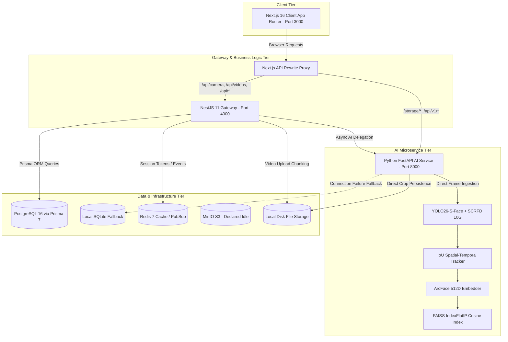

# Architecture As-Is & Preliminary Findings Evaluation — SmartCampus AI

This document presents the actual as-is architecture of the SmartCampus AI platform based on direct code inspection and empirical validation, followed by a formal re-evaluation of previous audit findings.

---

## 1. Actual Architecture Map & Service Topology

### Communication Protocols & Runtime Boundaries
1. **Frontend to API Gateway**:
   - HTTP REST calls targeting `/api/*` are handled by NestJS on port 4000.
   - Next.js rewrite rules in `apps/web/next.config.ts` transparently route `/api/camera/:path*` and `/api/videos/:path*` to the NestJS gateway, and `/storage/:path*` to the AI microservice.
2. **Real-Time Streaming**:
   - Live video camera display uses multipart MJPEG streaming (`multipart/x-mixed-replace`) over HTTP chunked transfer encoding.
   - Real-time alerts and attendance notifications use Socket.IO WebSockets on the NestJS Gateway (`apps/api/src/campus/campus.gateway.ts`).
3. **AI Inference & Vector Operations**:
   - In-memory execution using ONNX Runtime (SCRFD 10G, ArcFace) and PyTorch (YOLO26-S-Face).
   - FAISS executes exact inner-product vector comparisons directly against 512-dimensional L2-normalized vectors.

---

## 2. Re-Evaluation of Preliminary Audit Findings

Below is the revalidation of the eight findings reported in previous documentation against the current active codebase:

| Finding ID | Previous Audit Description | Current Revalidation Status | Concrete Evidence in Current Repository |
| :---: | :--- | :---: | :--- |
| **F-01** | Missing `POST /api/behavior/resolve` endpoint | **CONFIRMED** | `apps/ai-service/app/behavior/persistence.py:218` formats URL `f"{base}/api/behavior/resolve"` when resolving an active episode. `apps/api/src/behavior/behavior.controller.ts` only defines `/ingest`, `/alerts/:id/acknowledge`, and `/dismiss`. Endpoint returns 404. |
| **F-02** | Mock-token authentication fallback in frontend | **CONFIRMED** | `apps/web/src/lib/store/auth.ts:28-30` explicitly hardcodes `document.cookie = "refreshToken=mock-token-123; path=/"; setAccessToken("mock-token-123");` during login and register. |
| **F-03** | Significant frontend and backend lint problems | **CONFIRMED** | Backend has **994 problems** (973 errors, 21 warnings); Frontend has **510 problems** (278 errors, 232 warnings; including `react-hooks/set-state-in-effect`). Total: 1,504 lint issues. |
| **F-04** | Insufficient automated frontend and backend tests | **CONFIRMED** | `apps/web` contains **0** test files. `apps/api` contains only 1 unit test file (`app.controller.spec.ts`) and 1 e2e test (`app.e2e-spec.ts`). |
| **F-05** | Incomplete Celery background-worker integration | **CONFIRMED** | `celery==5.4.0` is installed, and broker URLs are in `settings.py`, but no Celery task modules or worker daemons process video jobs; heavy enrollment jobs run on FastAPI `BackgroundTasks` in-process threads. |
| **F-06** | Declared but unused MinIO storage integration | **CONFIRMED** | MinIO container is provisioned in `docker-compose.yml`, but neither NestJS nor FastAPI imports an AWS S3/MinIO SDK. Video uploads and crop images save directly to local disk paths (`uploads/`, `storage/`, `vectors/`). |
| **F-07** | Prototype dashboards relying on hardcoded data | **CONFIRMED** | `apps/web/src/app/dashboard/ai-brain/page.tsx`, `digital-twin/page.tsx`, and `ai-datasets/page.tsx` render static hardcoded mock data arrays (`const AGENTS = [...]`). |
| **F-08** | Gaps in unknown-face review integration | **CONFIRMED (With Path Correction)** | The previous audit cited a non-existent path `apps/web/src/app/dashboard/enrollment/review/page.tsx`. In reality, the review UI exists inside `apps/web/src/app/dashboard/face-enrollment/page.tsx` (under the "UNKNOWN" tab) and `/teacher/unknown-faces/page.tsx`. However, the integration gap itself is **CONFIRMED**: `/teacher/unknown-faces` falls back to `MOCK_CLUSTERS` with Unsplash image URLs when live fetch fails. |

---

## 3. Discovered Architectural Inconsistencies

1. **Dual Storage Model**:
   - `docker-compose.yml` launches MinIO, but application services bypass it and store files on local disk volumes. Multi-instance scaling will cause file locality failures unless a shared volume or S3 SDK is configured.
2. **Dual Database Connectivity in AI Microservice**:
   - `apps/ai-service/app/config/database.py` contains automatic fallback to SQLite (`smartcampus_dev.db`) if PostgreSQL is unavailable. While resilient for offline developer testing, this can silently cause split-brain data states where the NestJS API writes to PostgreSQL while the AI engine writes to local SQLite.
3. **Client-Side Rewrite Proxy vs Direct Service Invocation**:
   - While `apps/web/next.config.ts` introduces transparent proxying for `/storage/*` and `/api/camera/*`, legacy components in `apps/web` still construct URLs using `http://localhost:8000` or `http://localhost:4000`, causing mixed content and CORS issues in deployed environments.
