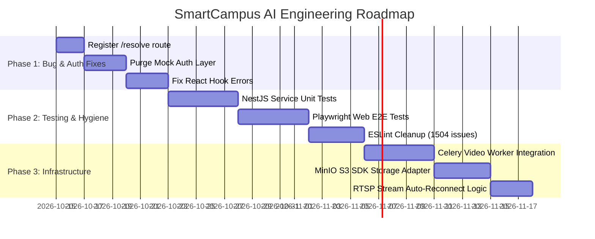

# Recommended Next Steps & Roadmap — SmartCampus AI

This document outlines the three highest-priority next actions, high-risk items requiring explicit approval, and a phased roadmap to transition SmartCampus AI from an advanced prototype to an enterprise-grade production platform.

---

## 1. Top Three Highest-Priority Next Actions

```
[Action 1: Register Route /api/behavior/resolve] -> [Action 2: Purge Frontend Mock Auth in auth.ts] -> [Action 3: Remediate React Hook Errors in useBehaviorAlerts.ts]
```

### Action 1: Register Missing `POST /api/behavior/resolve` Route in NestJS API
- **Why It Matters**: Concrete runtime bug. The AI service's background behavioral loop (`apps/ai-service/app/behavior/persistence.py:218`) constantly calls this endpoint, receiving HTTP 404 errors.
- **Implementation**:
  1. Add `@Post('resolve')` to `apps/api/src/behavior/behavior.controller.ts`.
  2. Implement `resolveAlerts(dto: ResolveBehaviorDto)` in `behavior.service.ts` to update alert statuses to `RESOLVED` in PostgreSQL.
- **Estimated Effort**: 2 hours.

### Action 2: Purge Frontend Mock Authentication Fallback in `auth.ts`
- **Why It Matters**: `apps/web/src/lib/store/auth.ts:28-30` explicitly sets synthetic `mock-token-123` tokens during login and registration, causing browser sessions to desynchronize from NestJS backend authentication.
- **Implementation**:
  1. Replace hardcoded mock tokens with real calls to NestJS `/api/auth/login` and `/api/auth/register`.
  2. Ensure authentication errors properly display in the UI and redirect to `/auth/login`.
- **Estimated Effort**: 4 hours.

### Action 3: Remediate React Hook Lifecycle Errors (`react-hooks/set-state-in-effect`)
- **Why It Matters**: 278 ESLint errors in `apps/web` involve calling `setState` synchronously within `useEffect` hooks (`useBehaviorAlerts.ts:57`, `demo-mode.tsx:45`, `useMediaQuery.ts:11`). This causes rendering cascades and browser performance stuttering.
- **Implementation**:
  1. Refactor `fetchAlerts()` to trigger via event listeners or interval timers without synchronous effect body `setState`.
  2. Clean up media query listener subscriptions.
- **Estimated Effort**: 6 hours.

---

## 2. High-Risk Changes Requiring Approval

The following architectural updates should **not** be executed autonomously and require explicit user/administrative sign-off:

1. **Celery Worker Task Queue Migration**:
   - Migrating video processing from FastAPI in-process threads to Celery workers requires validating Redis cluster persistence and configuring Celery process supervisor daemons.
2. **MinIO S3 Object Store Activation**:
   - Changing video storage paths from local filesystems to S3 bucket keys requires writing a database data migration script to re-map existing local paths to S3 URIs.
3. **Database Schema Pruning**:
   - Dropping unused prototype models (`CampusDrone`, `HologramNode`) from `prisma/schema.prisma` requires running a formal Prisma migration (`npx prisma migrate dev`) against the production PostgreSQL instance.

---

## 3. Phased Implementation Roadmap



### Phase 1: Immediate Stability (Days 1–5)
- Fix disconnected `/api/behavior/resolve` route.
- Remove synthetic client auth tokens.
- Fix React hook state-setting errors.

### Phase 2: Code Quality & Regression Protection (Days 6–15)
- Build Jest unit test suites for `StudentsService`, `AttendanceService`, `EnrollmentService`.
- Build Playwright E2E browser tests for attendance marking and monitoring.
- Resolve explicit `any` lint errors across backend and frontend.

### Phase 3: Enterprise Infrastructure & Scaling (Days 16–25)
- Decouple classroom video processing to Redis Celery workers.
- Integrate MinIO S3 object storage for multi-pod media distribution.
- Implement exponential backoff reconnection for physical RTSP camera streams.
