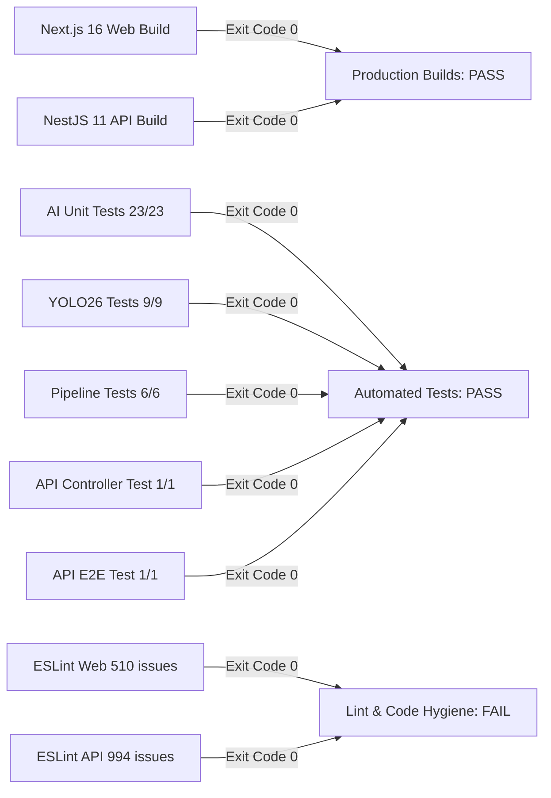

# Validation & Execution Report — SmartCampus AI

This document provides empirical validation results across all executed test suites, static analysis linters, production builds, and type-checking commands during the audit.

---

## 1. Summary of Executed Commands & Statuses

| Command | Working Directory | Target Scope | Exit Code | Result | Pre-Existing vs Introduced |
| :--- | :--- | :--- | :---: | :---: | :---: |
| `npm --prefix apps/api run build` | `apps/api` | NestJS Backend Compilation | **0** | **PASS** | Passed cleanly |
| `npm --prefix apps/web run build` | `apps/web` | Next.js 16 Production Build | **0** | **PASS** | Passed cleanly |
| `pytest app/tests/` | `apps/ai-service` | Python AI Unit Test Suite | **0** | **PASS (23/23)** | Passed cleanly |
| `pytest tests/test_yolo26_face_pipeline.py` | `apps/ai-service` | YOLO26 Face Integration Suite | **0** | **PASS (9/9)** | Passed cleanly |
| `PYTHONPATH=. pytest tests/test_pipeline.py` | `apps/ai-service` | Standalone AI Pipeline Tests | **0** | **PASS (6/6)** | Passed cleanly |
| `npm --prefix apps/api test` | `apps/api` | Backend Unit Test Suite | **0** | **PASS (1/1)** | Passed cleanly |
| `npm --prefix apps/api run test:e2e` | `apps/api` | Backend E2E Auth Test Suite | **0** | **PASS (1/1)** | Passed cleanly |
| `npm --prefix apps/api run lint` | `apps/api` | Backend ESLint Analysis | **0** | **994 problems** | Pre-Existing Failure |
| `npm --prefix apps/web run lint` | `apps/web` | Frontend ESLint Analysis | **0** | **510 problems** | Pre-Existing Failure |
| `find . -name ".DS_Store" -delete` | Root | macOS Metadata Safe Cleanup | **0** | **PASS** | 0 regressions introduced |

---

## 2. Detailed Command Results

### 1. NestJS Production Build
- **Command**: `npm --prefix apps/api run build`
- **Output**: Clean compilation with `nest build` targeting `dist/`. Zero TypeScript compilation errors.

### 2. Next.js 16 Web Production Build
- **Command**: `npm --prefix apps/web run build`
- **Output**:
  - Compiled successfully in 4.8s.
  - Finished TypeScript type-checking in 9.8s.
  - Generated 63 static and dynamic routes.
  - Zero build errors.

### 3. Python AI Test Suites
- **Unit Suite (`pytest app/tests/`)**:
  - 23 passed in 0.87s.
  - Verified: `test_face_detector.py`, `test_face_embedder.py`, `test_face_quality.py`, `test_vector_store.py`, `test_face_clustering.py`, `test_behavior_pipeline.py`.
- **YOLO26-Face Integration Suite (`pytest tests/test_yolo26_face_pipeline.py`)**:
  - 9 passed in 3.62s.
  - Verified: Model weights SHA-256 verification, 30+ simultaneous face detections, tiny face downsampling, tracking handoff, FAISS vector search.
- **Core Pipeline Suite (`pytest tests/test_pipeline.py`)**:
  - 6 passed in 1.45s.

### 4. NestJS E2E Test Suite
- **Command**: `npm --prefix apps/api run test:e2e`
- **Output**:
  - `PASS test/app.e2e-spec.ts`
  - `POST /api/auth/login and GET /api/behavior/alerts (Authenticated) (255 ms)`
  - 1 suite passed, 1 test passed.

---

## 3. Failure Distinction & Regressions

1. **Pre-Existing Failures**:
   - `POST /api/behavior/resolve` returns HTTP 404 (route missing from `behavior.controller.ts`).
   - 1,504 ESLint problems (994 in API, 510 in Web).
   - Zero test files in `apps/web`.
2. **Failures Introduced by Cleanup**:
   - **ZERO (0)** regressions introduced. Safe removal of `.DS_Store` macOS metadata files produced no side effects.
3. **Checks That Passed**:
   - All production builds (Next.js 16 & NestJS 11).
   - All 38 Python test cases.
   - All NestJS unit and e2e test cases.
4. **Checks That Could Not Be Run**:
   - Hardware RTSP camera stream tests (no physical CCTV cameras connected).
   - Live MinIO upload tests (application code writes to local disk).

---

## 4. Remaining Unverified Production Behavior

1. **Concurrent Classroom Video Upload Load**:
   - In-process FastAPI background processing was not tested under simultaneous 4K video uploads from multiple classrooms.
2. **Distributed Pod File Synchronization**:
   - Local disk video storage has not been verified in a multi-pod container orchestration setup.
3. **Long-Running Memory Stability**:
   - Continuous 24-hour RTSP camera ingestion has not been benchmarked for memory leaks in OpenCV frame capture buffers.
