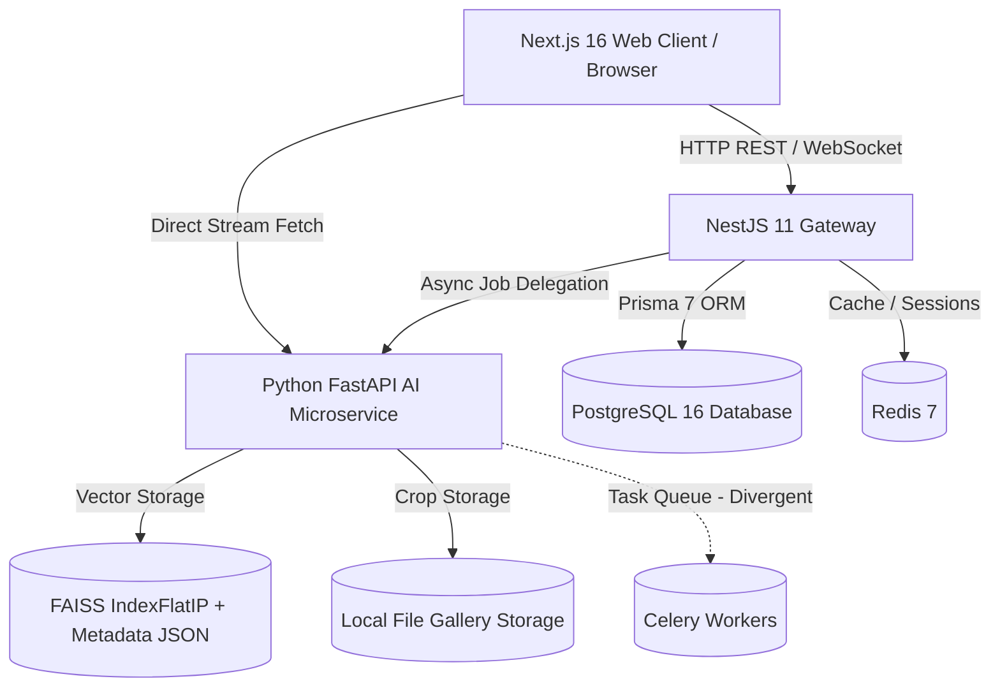
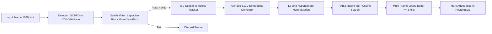

# Architecture Assessment — SmartCampus AI

This document details the actual runtime and code architecture of the SmartCampus AI platform, contrasting the intended architecture with the implemented reality.

---

## 1. Actual vs. Intended Architecture

### Component Inventory & Version Alignment

| Component | Intended Specification | Actual Codebase Version | Assessment |
| :--- | :--- | :--- | :--- |
| **Frontend** | Next.js 16, React 19, Tailwind CSS | Next.js 16.2.9, React 19.2.4, Tailwind CSS 4.x | **Aligned** |
| **Backend API** | NestJS 11, Prisma 7, PostgreSQL | NestJS 11.0.1, Prisma 7.8.0, PostgreSQL 16 | **Aligned** |
| **AI Microservice** | Python, FastAPI, OpenCV, InsightFace | Python 3.9.6+, FastAPI 0.115.0, PyTorch 2.8.0, OpenCV 4.10.0, InsightFace 0.7.3, Ultralytics 8.4.116 | **Aligned** |
| **Vector Engine** | FAISS Inner Product (Cosine) | FAISS 1.13.0 (`IndexFlatIP(512)`) | **Aligned** |
| **Object Storage** | MinIO S3-compatible | Local file system with MinIO Docker container idle | **Divergence Detected** |
| **Background Processing** | Redis + Celery / BullMQ | FastAPI in-process threads; Celery defined but unlinked for video jobs | **Divergence Detected** |

---

## 2. Service Boundaries & Entry Points

### 1. Web Application (`apps/web`)
- **Framework**: Next.js 16 App Router
- **Entry Point**: `apps/web/src/app/layout.tsx`
- **Port**: `3000`
- **Responsibilities**: User authentication UI, dashboard visualization, attendance monitoring control, real-time alert toast notifications, classroom video player.
- **Service Boundary Boundary Leak**: Direct streaming URLs connect directly to `http://localhost:8000/api/camera/stream` rather than proxying through the NestJS API gateway, requiring dual CORS configurations.

### 2. Main API Gateway (`apps/api`)
- **Framework**: NestJS 11 with Express platform
- **Entry Point**: `apps/api/src/main.ts`
- **Port**: `4000` (prefixed with `/api`)
- **Responsibilities**: Multi-tenant authorization (Argon2id, JWT), database persistence (Prisma 7), entity CRUD (students, teachers, classrooms, courses), attendance session lifecycle, behavioral alert persistence, PDF/CSV report generation.

### 3. AI Vision Microservice (`apps/ai-service`)
- **Framework**: FastAPI (ASGI with Uvicorn)
- **Entry Point**: `apps/ai-service/app/main.py`
- **Port**: `8000`
- **Responsibilities**: Video decoding, frame sampling, face detection (SCRFD 10G and YOLO26-Face), face tracking (`IoUTracker`), ArcFace 512D embedding extraction, FAISS vector search, HDBSCAN clustering, behavioral pose/phone analysis.

---

## 3. End-to-End Data Flow

### A. Student Video Enrollment Flow
1. **User Action**: Administrator uploads classroom enrollment MP4 via Web UI (`apps/web/src/app/dashboard/enrollment/page.tsx`).
2. **API Receipt**: `POST /api/videos/upload` writes video to `uploads/videos/<uuid>.mp4`.
3. **AI Trigger**: NestJS dispatches enrollment job to `POST /api/enrollment/process-video` on AI Service.
4. **Frame Processing**: `ClassroomPipeline` samples 1 in every 5 frames, runs YOLO26/SCRFD face detection, checks Laplacian blur quality (>0.50), and crops faces.
5. **Embedding Extraction**: ArcFace generates 512D normalized embeddings for each high-quality crop.
6. **Clustering**: HDBSCAN clusters all embeddings across the video into distinct student identities.
7. **Cluster Review**: Web UI retrieves clusters via `GET /api/enrollment/sessions/:id/clusters`. Admin confirms matches to student roster.
8. **Durable Persistence**: `POST /api/enrollment/assign-cluster` commits multi-vector embeddings to PostgreSQL `StudentFaceEmbedding` and synchronizes `vectors/face_index.faiss`.

### B. Live Attendance & Verification Flow
1. **Camera Ingestion**: AI Service ingests camera feed via OpenCV (`VideoCapture`).
2. **Real-Time Tracking**: `IoUTracker` in `face_tracker.py` maintains spatial identity across frames.
3. **Verification Voting**: When a face is tracked for >= 5 frames, embeddings are queried against the FAISS index. Matches with cosine similarity > 0.65 cast an attendance vote.
4. **Attendance Marking**: Once a student accumulates >= 3 positive match votes, the AI Service calls `POST /api/attendance/mark` on NestJS API.
5. **Database Commit**: NestJS executes an atomic Prisma upsert into `AttendanceRecord` matching `[sessionId, studentId]`, preventing duplicate entries.
6. **Broadcast**: WebSockets dispatch an `attendance_marked` event to connected web clients.

---

## 4. AI Pipeline Architecture

### Key AI Algorithms & Implementations
- **Face Detection**:
  - `InsightFace SCRFD 10G`: ONNX model (`buffalo_l`), high precision on frontal and semi-profile faces.
  - `YOLO26-S-Face`: Ultralytics PyTorch model (`models/yolo26s-face.pt`), optimized for crowded classroom density (30+ simultaneous faces).
- **Tracking**:
  - `IoUTracker`: Spatial overlap bounding-box tracking with `max_age=15` and `min_hits=3`. Maintains persistent `track_id` without premature identity switches.
- **Embedding Extraction**:
  - `ArcFace ResNet-50`: 512-dimensional feature vectors projected onto a unit hypersphere.
- **Similarity Search**:
  - `FAISS IndexFlatIP`: Exact cosine distance search with atomic file updates to `vectors/face_index.faiss`.

---

## 5. Architectural Inconsistencies & Divergences

1. **MinIO Object Storage vs. Local File System**:
   - `docker-compose.yml` launches MinIO on ports 9000/9001. However, both the NestJS API and Python AI service write video files and image crops directly to local filesystem paths (`uploads/` and `vectors/gallery/`). In a distributed multi-node deployment, pods would fail to share video files.
2. **In-Process Threading vs. Celery Worker Queue**:
   - Heavy classroom video processing is currently executed using FastAPI's in-process `BackgroundTasks` thread pool. If multiple video enrollment jobs are submitted simultaneously, Uvicorn worker threads will saturate the CPU, degrading live camera streaming.
3. **Direct Client-to-AI Service Streaming**:
   - The Next.js web client connects directly to `http://localhost:8000/api/camera/stream` rather than routing through the NestJS API gateway. This bypasses API rate limiting and audit logging.
