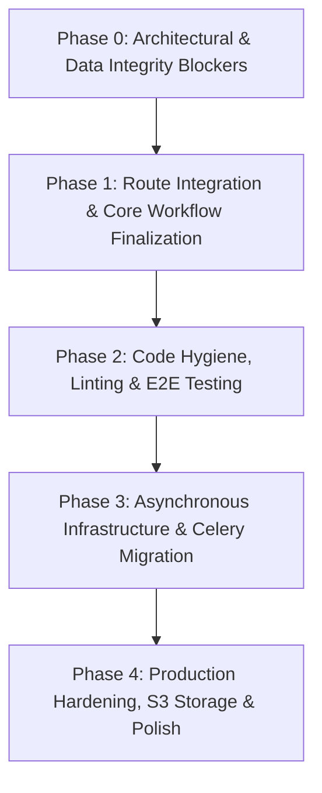

# Recommended Implementation Order — SmartCampus AI

This document provides a dependency-aware, phased roadmap for completing SmartCampus AI and taking it to enterprise production readiness. Architectural, security, and data-integrity blockers must be resolved before secondary features or cosmetic enhancements are tackled.

---

## Phase 0: Architectural & Data-Integrity Blockers (Immediate — Week 1)
*Goal: Eliminate runtime crashes, broken endpoints, and authentication desynchronization.*

1. **Step 0.1: Register Missing Route `POST /api/behavior/resolve` in NestJS API**
   - **Rationale**: The AI background loop repeatedly hits HTTP 404 when resolving behavioral alerts.
   - **Action**: Add `@Post('resolve')` to `apps/api/src/behavior/behavior.controller.ts` and implement the corresponding bulk status update in `behavior.service.ts`.
   - **Dependencies**: None.

2. **Step 0.2: Eliminate Client-Side Mock Auth Bypass (`userStore.ts`)**
   - **Rationale**: Dual authentication mechanisms corrupt user session state and hide API failures.
   - **Action**: Remove synthetic token generation in `apps/web/src/lib/userStore.ts`. Ensure all web requests use the real NestJS JWT token and redirect to `/login` on token expiry.
   - **Dependencies**: None.

3. **Step 0.3: Fix Critical React Hook Rule Violations in Web Client**
   - **Rationale**: `react-hooks/set-state-in-effect` errors cause re-render loops and UI degradation.
   - **Action**: Refactor synchronous `setState` invocations in `useBehaviorAlerts.ts`, `demo-mode.tsx`, and `useMediaQuery.ts` to use event-based or external subscription patterns.
   - **Dependencies**: Step 0.2.

---

## Phase 1: Core Workflow Finalization & Integration (Week 2)
*Goal: Complete all incomplete primary workflows (Unknown-Face Review, Timetables).*

1. **Step 1.1: Complete Unknown-Face Review UI Mutation Binding**
   - **Rationale**: Administrators must be able to resolve unassigned classroom face crops into confirmed student profiles.
   - **Action**: Wire the review interface (`apps/web/src/app/dashboard/enrollment/review/page.tsx`) to `/api/enrollment/assign-cluster` and implement optimistic UI updates.
   - **Dependencies**: Phase 0.

2. **Step 1.2: Complete Timetable / Schedule Management Flow**
   - **Rationale**: Subject timetable assignments are defined in the Prisma schema but lack full CRUD in the web UI.
   - **Action**: Wire the classroom timetable editor modal to dispatch save requests to `TimetableService`.
   - **Dependencies**: Step 0.2.

3. **Step 1.3: Demote or Feature-Flag Futuristic Prototype Dashboards**
   - **Rationale**: Pages like `ai-brain` and `digital-twin` render static mock data, creating confusion for end users.
   - **Action**: Add a "Roadmap Preview" badge or feature-flag them behind an `ENABLE_PROTOTYPES=false` configuration.
   - **Dependencies**: None.

---

## Phase 2: Code Hygiene & Automated Testing (Week 3)
*Goal: Establish robust automated test coverage and eliminate technical debt.*

1. **Step 2.1: Remediate Remaining ESLint Problems across API and Web**
   - **Rationale**: 1,504 lint problems indicate substantial technical debt and loose type safety.
   - **Action**: Replace `@typescript-eslint/no-explicit-any` with explicit TypeScript interfaces in `apps/api` and `apps/web`. Clean up unused imports and empty catch blocks.
   - **Dependencies**: Phase 1.

2. **Step 2.2: Implement NestJS API Unit & Integration Test Suites**
   - **Rationale**: Core business logic currently has only 1 unit test and 1 e2e test.
   - **Action**: Add Jest test suites for `StudentsService`, `AttendanceService`, `EnrollmentService`, and `BehaviorService`, targeting at least 70% branch coverage.
   - **Dependencies**: Phase 1.

3. **Step 2.3: Implement Playwright End-to-End Browser Tests**
   - **Rationale**: Zero automated frontend test coverage exists.
   - **Action**: Implement Playwright tests verifying login, class roster viewing, live monitoring toggle, and report export.
   - **Dependencies**: Step 2.1.

---

## Phase 3: Asynchronous Infrastructure & Celery Migration (Week 4)
*Goal: Prevent CPU starvation and enable multi-node horizontal scalability.*

1. **Step 3.1: Migrate Long-Running Video Processing to Celery Worker Pool**
   - **Rationale**: In-process FastAPI `BackgroundTasks` threads block HTTP requests during heavy classroom video processing.
   - **Action**: Connect `ClassroomPipeline` video processing to the Redis Celery worker pool defined in `apps/ai-service/app/tasks/`.
   - **Dependencies**: Phase 0.

2. **Step 3.2: Activate MinIO S3 Object Storage for Video and Crop Assets**
   - **Rationale**: Local disk paths prevent horizontal multi-pod deployment.
   - **Action**: Implement S3 client helpers in NestJS and FastAPI to stream video files and store keyframe crops directly in MinIO buckets.
   - **Dependencies**: Step 3.1.

3. **Step 3.3: Implement RTSP Reconnection Logic & Hardware Decoding**
   - **Rationale**: Physical CCTV streams experience network packet loss and hardware disconnects.
   - **Action**: Wrap `cv2.VideoCapture` with exponential backoff and optional FFmpeg hardware acceleration.
   - **Dependencies**: None.

---

## Phase 4: Production Hardening & Deployment (Week 5)
*Goal: Prepare the platform for enterprise multi-campus deployment.*

1. **Step 4.1: Production Ingress, SSL Termination & Rate Limiting**
   - **Action**: Finalize Nginx reverse proxy configuration with TLS certificate management and DDoS rate limiting.
2. **Step 4.2: Structured Logging and OpenTelemetry APM**
   - **Action**: Instrument NestJS and FastAPI with structured JSON log formatters and OpenTelemetry distributed tracing.
3. **Step 4.3: Disaster Recovery & Vector Backup Automation**
   - **Action**: Automate daily incremental backups of PostgreSQL database and FAISS index files to secure remote cold storage.
